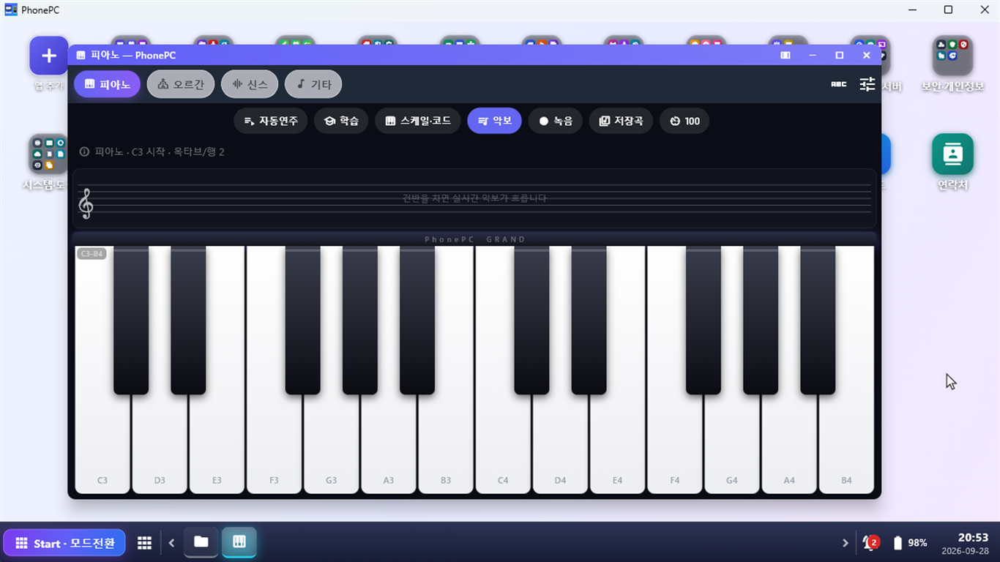
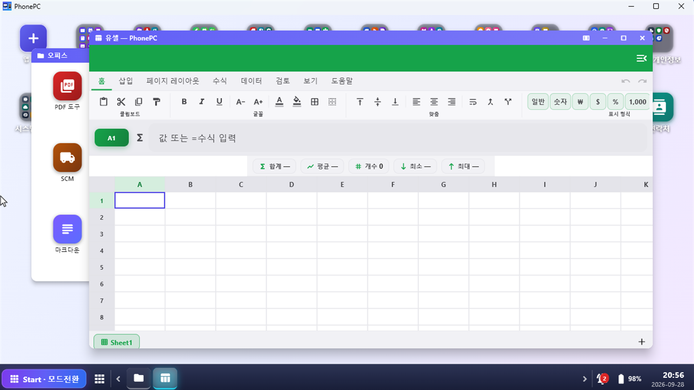
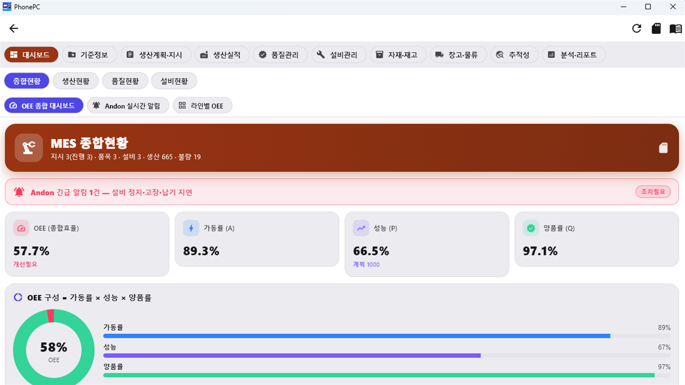
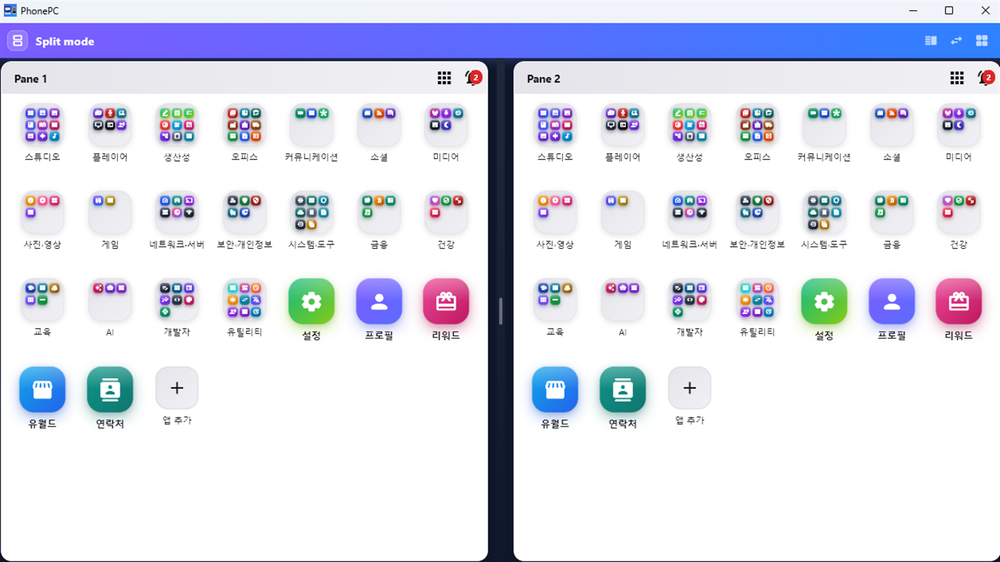
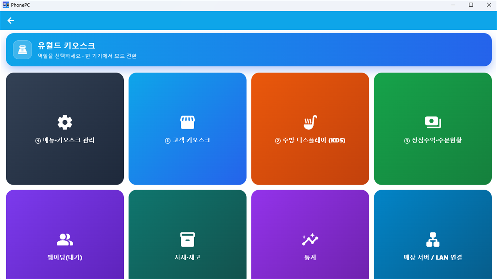
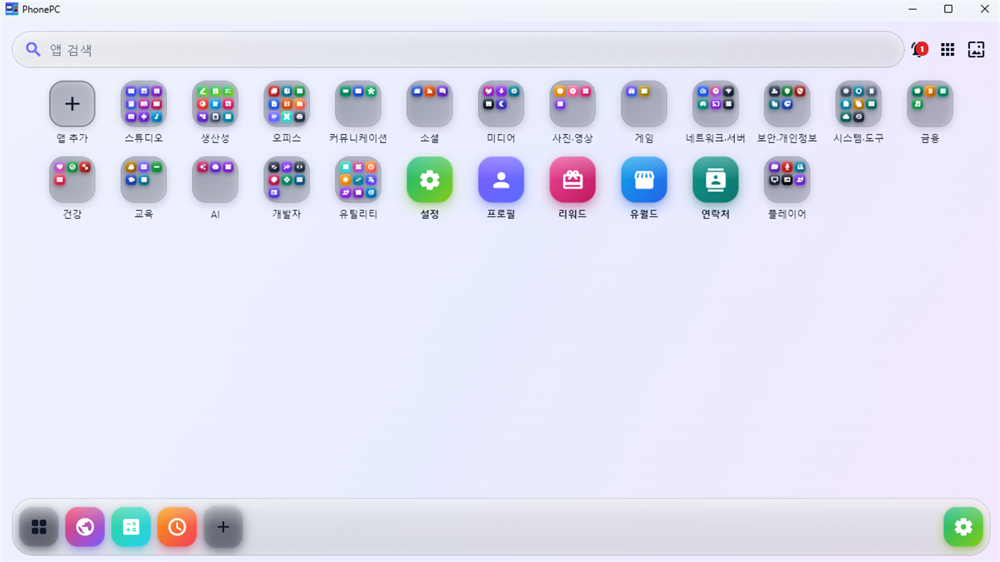

<div align="center">

# PhonePC · 폰PC

**One app, a whole desktop — 100+ built-in apps that work on your own device, even offline.**
**앱 하나로 데스크톱 전체를 — 100개가 넘는 내장 앱을 내 기기 안에서, 인터넷 없이도.**

[](https://github.com/UWorld-Group/phonepc/releases/latest)
[](https://github.com/UWorld-Group/phonepc/releases)

| Windows | macOS | Android | iPhone · iPad |
|:---:|:---:|:---:|:---:|
| [**Download**](https://github.com/UWorld-Group/phonepc/releases/latest) · [Microsoft Store](https://apps.microsoft.com/detail/XPFFBC24DTK671) | [**DMG**](https://github.com/UWorld-Group/phonepc/releases/latest) (Apple silicon) | [Google Play](https://play.google.com/store/apps/details?id=com.DRSP.phonepc) (+ Wear OS) | Coming soon · App Store 출시 준비 중 |

</div>

## Screenshots · 화면

<p align="center">
  
  
</p>
<p align="center">
  
  
</p>
<p align="center">
  
  
</p>

---

## Why PhonePC · 왜 PhonePC인가

Most of us juggle dozens of small apps — a note app here, a PDF viewer there, a separate tool for every job — each with its own account, ads and subscription. **PhonePC puts a complete, consistent workspace into one app**: office documents, business tools, media, music, games, developer utilities and on-device AI, all designed to work together and all running on your own computer.

PhonePC was built **on-device first**. Your files stay on your computer, most apps work without an internet connection, and there are no ads and no third-party analytics. When you do want to connect — your own cloud drive, your own server, or another of your devices — you choose it, and it stays under your control.

The same PhonePC runs on **Windows, macOS, Android, iPhone and iPad** with the same apps and the same look, so you can start on one device and continue on another.

수많은 작은 앱을 따로 깔고, 앱마다 계정·광고·구독을 관리하느라 지치셨나요? **PhonePC는 하나의 앱 안에 일관된 작업 공간 전체를 담았습니다.** 오피스 문서, 업무 도구, 미디어, 음악, 게임, 개발 도구, 온디바이스 AI까지 서로 연결되어 동작하며, 모두 내 컴퓨터 안에서 실행됩니다.

PhonePC는 **처음부터 기기 안에서 동작하도록** 만들었습니다. 파일은 내 컴퓨터에 남고, 대부분의 앱은 인터넷 없이도 쓸 수 있으며, 광고와 외부 분석 도구가 없습니다. 클라우드 드라이브·내 서버·내 다른 기기와 연결할 때도 연결 대상은 사용자가 직접 고릅니다.

**Windows·macOS·Android·iPhone·iPad**에서 같은 앱과 같은 화면으로 동작하므로, 한 기기에서 시작한 작업을 다른 기기에서 이어 갈 수 있습니다.

## Features · 주요 기능

### 🖥️ Four modes on one screen · 네 가지 화면 모드
- **PC mode** — A desktop with a taskbar, Start menu and resizable, snappable windows. Run several built-in apps side by side.
  작업 표시줄·시작 메뉴·크기 조절과 정렬이 되는 창을 갖춘 데스크톱. 여러 내장 앱을 나란히 실행합니다.
- **Split mode** — Two apps side by side, each with its own navigation.
  두 앱을 좌우로 나눠 각각 독립적으로 사용합니다.
- **TV mode** — A 10-foot, remote-friendly interface for media and the streams you add yourself.
  리모컨으로도 다루기 쉬운 큰 화면 인터페이스로, 미디어와 직접 추가한 방송을 봅니다.
- **Phone mode** — A familiar home screen with folders, search and a dock. Switch modes at any time.
  폴더·검색·독이 있는 익숙한 홈 화면. 언제든 모드를 바꿀 수 있습니다.

### 📄 Office & documents · 오피스와 문서
- Word processor, spreadsheet with formulas, presentations, Markdown, PDF viewer with pen, highlighter and eraser, handwriting notes and a document scanner.
  문서 편집기, 수식이 되는 스프레드시트, 프레젠테이션, 마크다운, 펜·형광펜·지우개 필기가 되는 PDF 뷰어, 손글씨 노트, 문서 스캐너.
- Export to common formats (DOCX, XLSX, PPTX, PDF, HTML, Markdown and plain text), and print.
  DOCX·XLSX·PPTX·PDF·HTML·마크다운·텍스트 등 흔히 쓰는 형식으로 내보내고 인쇄할 수 있습니다.

### 🏭 Business suite · 업무 도구
- ERP, MES, SCM, CRM with business cards, quotations and invoices, kiosk and kitchen display, inventory and approvals — sharing one set of master data.
  ERP·MES·SCM·명함 연동 CRM·견적서·청구서·키오스크와 주방 화면·재고·결재가 하나의 기준 정보를 함께 씁니다.
- QR and barcode scanning to cut down manual typing; optional connection to your own database server.
  QR·바코드 스캔으로 손 입력을 줄이고, 원하면 내 데이터베이스 서버와 연결할 수 있습니다.

### 🤖 On-device AI · 기기 안에서 실행되는 AI
- Download the open models you choose and run them on your own computer: AI chat, summarizing, translation, text recognition (OCR), image tools and more.
  원하는 공개 모델을 내려받아 내 컴퓨터에서 직접 실행합니다. AI 채팅, 요약, 번역, 글자 인식(OCR), 이미지 도구 등.
- Your prompts and documents are processed locally; connecting a commercial AI service with your own key is optional.
  입력과 문서는 기기 안에서 처리되며, 상용 AI 서비스 연결(본인 키 사용)은 선택 사항입니다.

### 🎬 Media & music · 미디어와 음악
- Hardware-accelerated video player, music player, photo viewer, audio and video editing, screen recording.
  하드웨어 가속 동영상 플레이어, 음악 플레이어, 사진 보기, 오디오·영상 편집, 화면 녹화.
- Piano, organ, synth and 18 string instruments with live sheet music and tablature, recording and practice modes.
  피아노·오르간·신스와 18가지 현악기, 실시간 악보·타브 악보, 녹음과 연습 모드.

### 🎮 Game Center · 게임 센터
- A collection of classic games built into PhonePC — board games such as Omok, Go, Janggi, Chess and Othello, plus puzzles — with stages, records and play with a friend nearby.
  오목·바둑·장기·체스·오델로 같은 보드게임과 퍼즐 등 PhonePC에 내장된 게임 모음. 스테이지·기록, 가까운 친구와 함께하기를 지원합니다.

### 🔗 Your devices, connected · 내 기기 연결
- Pair your own Windows, Mac, Android and iOS devices (with your free PhonePC account) to send files, share the clipboard and back up photos and videos to your own computer — directly between your devices.
  (무료 PhonePC 계정으로) 내 Windows·Mac·Android·iOS 기기를 페어링해 파일 보내기·클립보드 공유·사진과 영상 백업을 기기끼리 직접 주고받습니다.
- Built-in LAN chat, video calls, file sharing and screen casting — no outside server required.
  외부 서버 없이 LAN 채팅·영상 통화·파일 공유·화면 송출을 제공합니다.

### ⌚ Watch & smart glasses · 워치와 스마트 안경
- **Watch** — Manage a Wear OS watch (Galaxy Watch) or an Apple Watch from PhonePC: watch faces and complications, notification rules, voice dictation, a camera remote and on-wrist AI answers that are worked out on your phone.
  **워치** — Wear OS 워치(갤럭시 워치)나 Apple Watch를 PhonePC에서 관리합니다. 시계 화면·컴플리케이션, 알림 규칙, 음성 받아쓰기, 카메라 리모컨, 폰에서 처리한 AI 답변을 손목에서 받습니다.
- **Smart glasses** — Live captions, "ask about what I see", scene description and today's log for smart glasses. On Android, Android XR glasses are supported out of the box; a try-out mode works without any glasses.
  **스마트 안경** — 실시간 자막, 보이는 것 묻기, 장면 설명, 오늘 기록. Android에서는 Android XR 안경을 바로 지원하며, 안경이 없어도 체험 모드로 써 볼 수 있습니다.

### 🛠️ Developer & network tools · 개발·네트워크 도구
- SSH terminal and SFTP with tabs, remote desktop (VNC), JSON/Base64/hash tools, a local web server, colour tools and system information.
  탭이 있는 SSH 터미널과 SFTP, 원격 데스크톱(VNC), JSON·Base64·해시 도구, 로컬 웹 서버, 색상 도구, 시스템 정보.
- Connect to Google Drive, your own NAS or server when you choose to.
  원할 때 Google Drive·내 NAS·내 서버에 연결할 수 있습니다.

### 🌍 35 languages · 35개 언어
- The whole interface is available in 35 languages, including right-to-left languages such as Arabic and Hebrew.
  아랍어·히브리어 같은 오른쪽→왼쪽 언어를 포함해 35개 언어로 사용할 수 있습니다.

### 🔒 Private by design · 개인정보 보호
- No account required to start, no ads, no third-party analytics. What you create is saved on your own computer (on Windows in `Documents\PhonePC`).
  시작할 때 계정이 필요 없고, 광고와 외부 분석 도구가 없습니다. 만든 파일은 내 컴퓨터에 저장됩니다(Windows는 `문서\PhonePC` 폴더).

---

## Install · 설치 안내

### Windows

**Requirements · 사양**: Windows 10 / 11 (64-bit). About 1 GB of free disk space. Internet connection only for online features.
Windows 10 / 11 (64비트), 저장 공간 약 1GB. 인터넷은 온라인 기능에만 필요합니다.

1. Download **`PhonePC-<version>-windows-x64-setup.exe`** from the [latest release](https://github.com/UWorld-Group/phonepc/releases/latest).
   [최신 릴리스](https://github.com/UWorld-Group/phonepc/releases/latest)에서 설치 파일을 내려받습니다.
2. Run it and follow the installer. The installer and the app are code-signed by **유월드 (UWorld)**. The Microsoft Visual C++ runtime is installed automatically if needed.
   실행하면 설치가 진행됩니다. 설치 파일과 프로그램은 **"유월드"** 이름으로 서명되어 있으며, 필요하면 Microsoft Visual C++ 런타임이 자동으로 설치됩니다.
3. Open **PhonePC** from the Start menu or the desktop icon. A newer version installs over the old one; uninstall from *Settings › Apps*.
   시작 메뉴나 바탕 화면 아이콘으로 엽니다. 새 버전은 기존 설치 위에 그대로 업데이트되며, 제거는 *설정 › 앱*에서 합니다.
4. *(Optional)* Verify the file with `SHA256SUMS.txt` from the same release:
   *(선택)* 같은 릴리스의 `SHA256SUMS.txt` 로 파일이 변조되지 않았는지 확인할 수 있습니다.
   ```powershell
   Get-FileHash .\PhonePC-<version>-windows-x64-setup.exe -Algorithm SHA256
   ```

You can also install PhonePC from the [Microsoft Store](https://apps.microsoft.com/detail/XPFFBC24DTK671).
[Microsoft Store](https://apps.microsoft.com/detail/XPFFBC24DTK671)에서도 설치할 수 있습니다.

### macOS (DMG)

**Requirements · 사양**: macOS 14 (Sonoma) or later, **Apple silicon** (M1 or later).
macOS 14(Sonoma) 이상, **Apple 실리콘**(M1 이상) Mac.

1. Download **`PhonePC-<version>-macos-arm64.dmg`** from the [latest release](https://github.com/UWorld-Group/phonepc/releases/latest) and open it.
   최신 릴리스에서 DMG를 내려받아 엽니다.
2. Drag **PhonePC** onto **Applications**. The app is signed with UWorld's Developer ID and **notarized by Apple**. The first time you open it, macOS asks *"PhonePC is an app downloaded from the Internet. Are you sure you want to open it?"* — click **Open** (asked only once).
   **PhonePC**를 응용 프로그램(Applications) 폴더로 끌어다 놓습니다. 유월드 Developer ID 서명과 Apple 공증을 받은 앱입니다. 처음 열 때 "인터넷에서 다운로드한 앱입니다. 열겠습니까?" 창이 뜨면 **열기**를 누르세요(처음 한 번만 묻습니다).
3. macOS asks once for permissions such as camera, microphone or local network only when a feature needs them.
   카메라·마이크·로컬 네트워크 등의 권한은 해당 기능을 처음 쓸 때 한 번만 묻습니다.
4. *(Optional)* Verify the file: `shasum -a 256 PhonePC-<version>-macos-arm64.dmg`
   *(선택)* 파일 확인: `shasum -a 256 PhonePC-<version>-macos-arm64.dmg`
5. To update, download the newer DMG from the latest release and drag it onto Applications again — your settings and data are kept. To remove PhonePC, move it to the Trash; its data lives in `~/Library/Containers/com.DRSP.phonepc`.
   업데이트는 최신 릴리스의 새 DMG를 받아 같은 방법으로 덮어 놓으면 되며 설정과 데이터는 그대로입니다. 제거는 앱을 휴지통으로 옮기면 되고, 데이터는 `~/Library/Containers/com.DRSP.phonepc` 폴더에 있습니다.

### Android · iPhone · iPad
- Android (phones, tablets, foldables) and Wear OS watches: [Google Play](https://play.google.com/store/apps/details?id=com.DRSP.phonepc)
  Android(폰·태블릿·폴더블)와 Wear OS 워치: Google Play
- iPhone · iPad: coming soon on the App Store · App Store 출시 준비 중

---

## About this repository · 이 저장소에 대해

This repository is used **only to distribute installers**. The source code is not published here.
The "Source code" archives that GitHub attaches to every release contain only this README, the license and the screenshots.

이 저장소는 **설치 파일 배포 전용**입니다. 앱 소스코드는 공개하지 않으며, 릴리스마다 GitHub가 자동으로 붙이는 "Source code" 압축 파일에는 이 안내문·사용권 안내·화면 이미지만 들어 있습니다.

## Support · 문의

- Website · 웹사이트: https://service.uworld.co.kr

<div align="center">

Part of **[UWorld Group](https://github.com/UWorld-Group)** · See [LICENSE.txt](LICENSE.txt) · © UWorld. All rights reserved.

</div>
